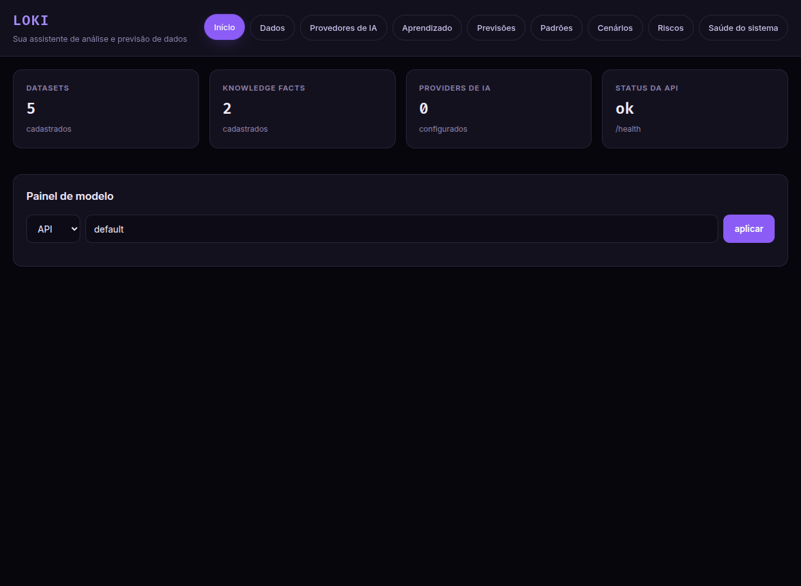
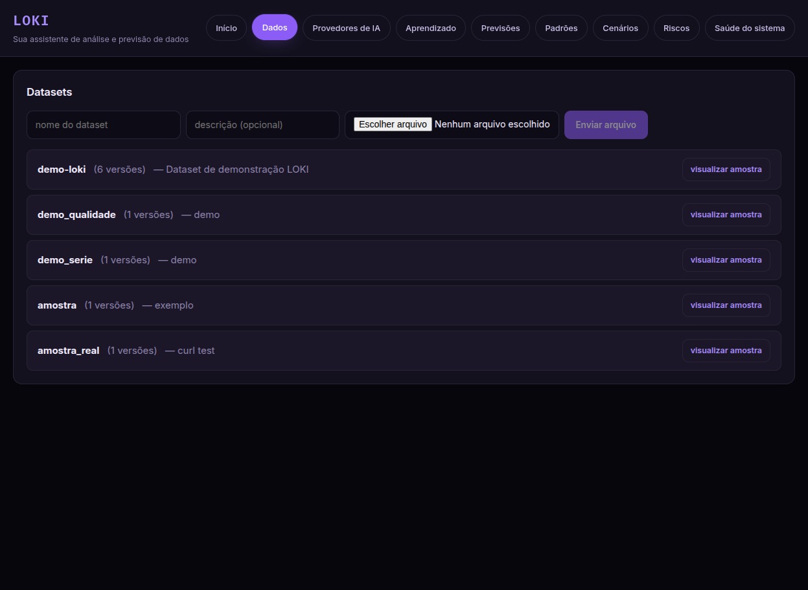
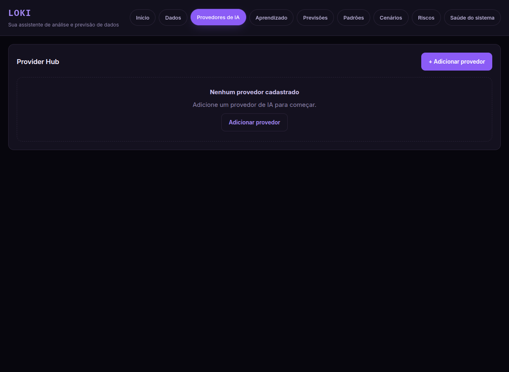
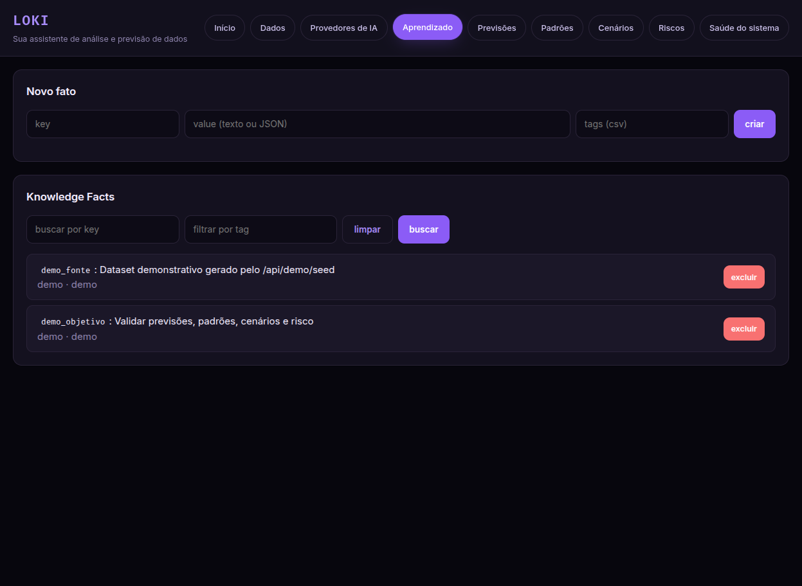
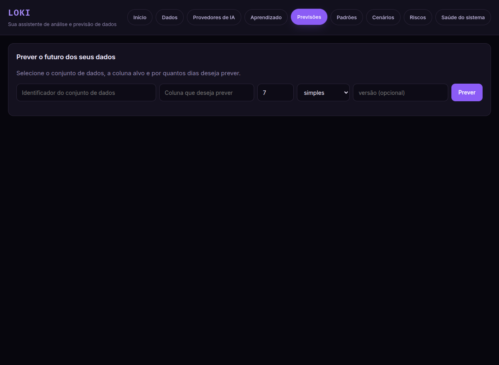
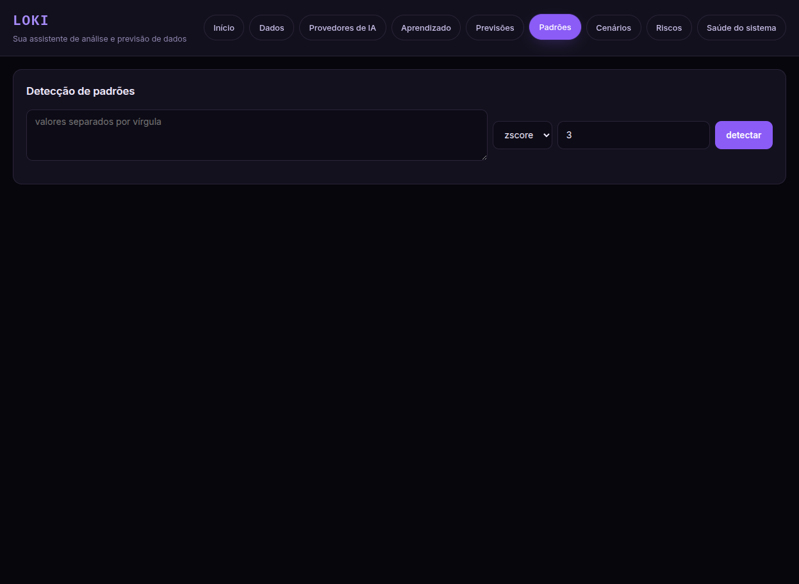
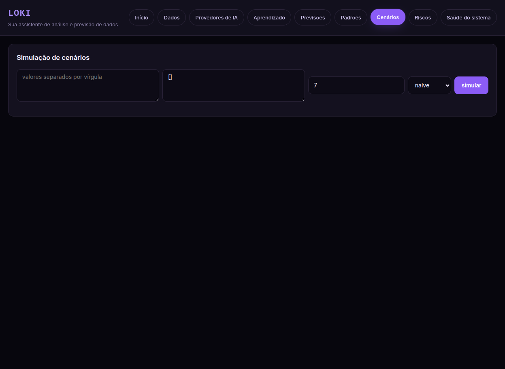
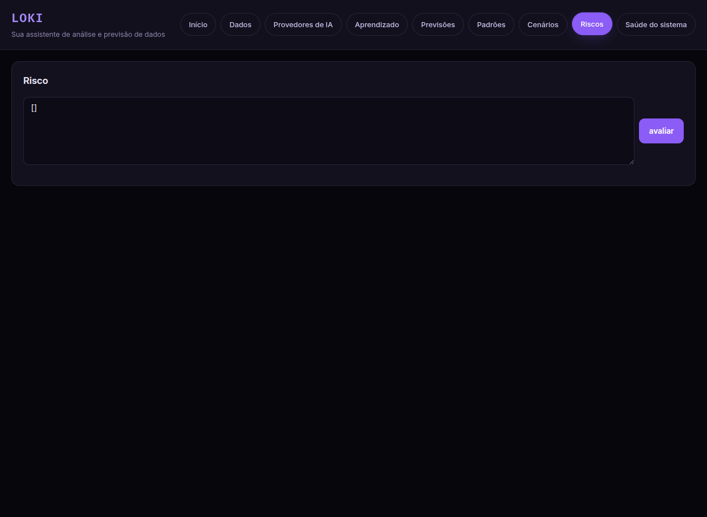
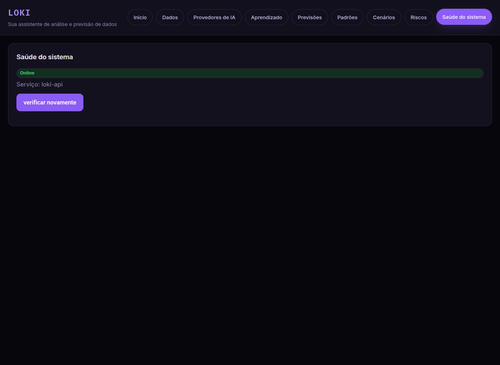

# LOKI — Predictive Intelligence System

LOKI é uma plataforma de **inteligência preditiva** para análise, previsão e simulação de séries temporais. O foco é permitir que um analista leigo envie dados, prepare uma versão, gere previsões, detecte padrões, simule cenários e avalie riscos sem precisar escrever código.

## O que existe hoje

- Frontend React (Vite) com interface em português, tabs acessíveis e design dark/violet.
- Backend FastAPI com pipeline de dados, base de conhecimento, provedores híbridos e Provider Hub de IA.
- Motor de previsão baseline (`naive`, `seasonal_naive`, `moving_average`).
- Detecção de anomalias (z-score / IQR), cenários e risco.
- Monitoramento de uso de provedores de IA e logs em Redis (quando disponível).
- Autenticação opcional por token (`LOKI_API_TOKEN`).

## Arquitetura (resumo)

- `backend/app/api`: rotas FastAPI (datasets, predictions, pattern, scenario, risk, learning, knowledge, providers, ai-providers).
- `backend/app/data`: ingest, validate, profile, outliers, prepare (splits).
- `backend/app/engines` e módulos `prediction`, `pattern`, `scenario`, `risk`, `learning`, `knowledge`.
- `backend/app/core`: config, logging, erros, event bus, scheduler, registry de providers, auth.
- `frontend/src`: SPA com tabs e páginas.

## Como rodar (Docker)

```bash
cp .env.example .env
docker compose up -d --build
curl http://localhost:8100/health
```

Portas padrão:
- API: `8100`
- Postgres: `5434`
- Redis: `6381`
- Frontend (dev/preview): `5173/5174`

## Como rodar o frontend em desenvolvimento

```bash
cd frontend
npm install
npm run dev      # http://localhost:5173
# ou
npm run build && npm run preview
```

## Fluxo típico do usuário

1. **Dados** → envie um CSV/XLSX/Parquet.
2. **Previsões** → escolha coluna alvo, método e horizonte.
3. **Padrões** → detecte anomalias.
4. **Cenários** → simule alterações de escala/valores.
5. **Riscos** → consolide sinais.
6. **Provedores de IA** → configure OpenAI/Ollama/custom e teste conexão.

## Provider Hub

- Cadastro de provedores com URL base, modelo e chave.
- Teste de conexão e listagem automática de modelos (suporte Ollama via `/api/tags`).
- Criptografia da API key fora do banco (`LOKI_SECRET_KEY`).
- Histórico de uso e disponibilidade.

## Variáveis de ambiente relevantes

- `LOKI_SECRET_KEY`: chave mestra para credenciais.
- `LOKI_API_TOKEN`: token opcional para API.
- `LOKI_DATASETS_DIR`, `LOKI_MAX_UPLOAD_MB`.
- `REDIS_URL`, `POSTGRES_*`.

## Demonstrações

Capturas das abas (geradas em `docs/screenshots/`):











## Testes

```bash
cd backend
uv run pytest -q
uv run ruff check .
```

Frontend:
```bash
cd frontend
npm run lint
npm run build
```

## Status e limitações

- Motores de IA são baselines determinísticos; previsões probabilísticas estão no intervalo residual normal.
- Autenticação é por token único (sem usuários/roles).
- Monitoramento de consumo é estimado (tokens apenas quando o provedor informa).
- Sem Kafka/queue distribuída: scheduler in-process + Redis Streams.
